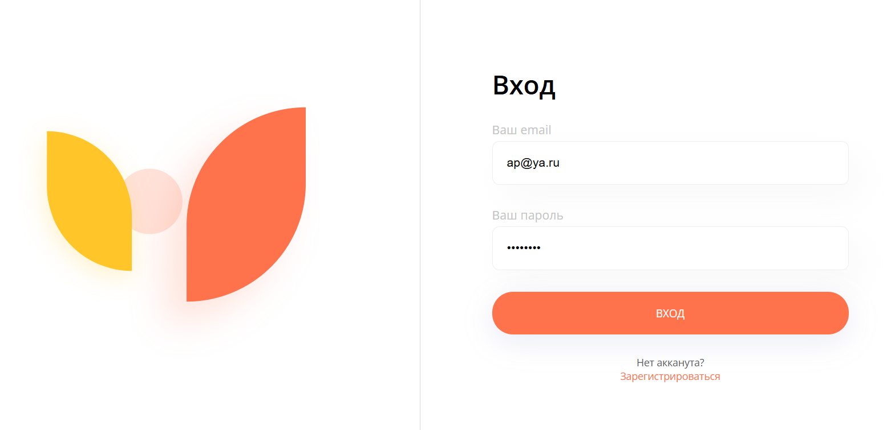
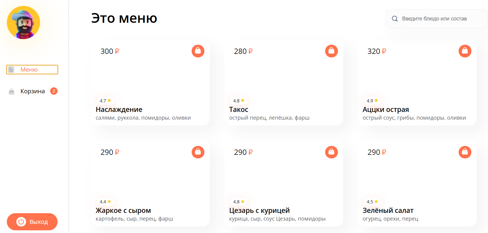
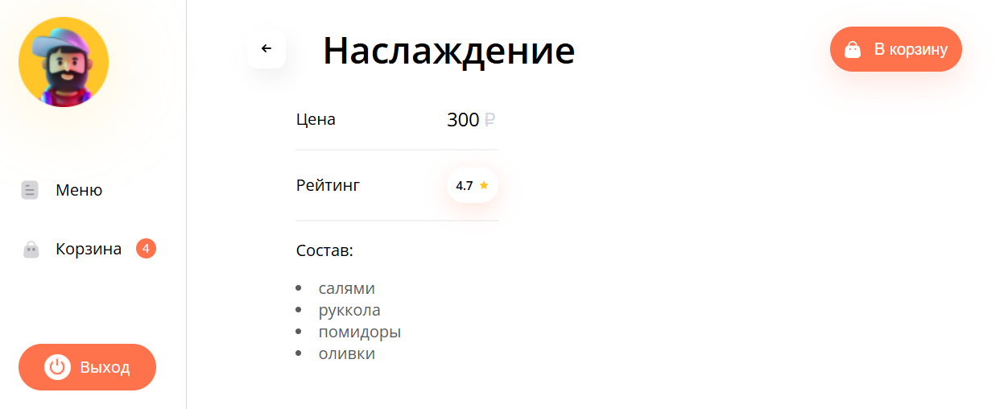

# Pizza app (Приложение пиццерии)

Учебный проект  Purpleschool на React + TypeScript + Vite. Интернет-магазин пиццерии с каталогом товаров, корзиной, авторизацией и оформлением заказа.

## Демонстрация

**Авторизация**

**Главная страница (Меню)**

**Корзина**

**Карточка товара**

## Функционал
- **Авторизация и регистрация** (защищенные маршруты через `RequireAuth`).
- **Каталог пицц** (ленивая загрузка страниц через `Suspense` и `lazy`).
- **Корзина** (добавление, изменение количества и удаление товаров). Управление состоянием реализовано через Redux Toolkit.
- **Страница товара** (динамические маршруты `product/:id` с загрузчиками данных `loader`).
- **Оформление заказа** (отправка данных на сервер, очистка корзины и редирект на страницу успеха).
- **Адаптивный дизайн** с использованием CSS Modules.

## Технологии
- **React 18** (Hooks, Context)
- **TypeScript**
- **Vite** (сборщик)
- **React Router DOM v6** (маршрутизация, `defer`, `loader`)
- **Redux Toolkit** (управление состоянием корзины и пользователя)
- **Axios** (HTTP-запросы)
- **CSS Modules**

## Установка и запуск

1. npm install
2. npm run dev
3. npm run build (опционально) - чтобы собрать проект для продакшена

Логин: ap@ya.ru

Пароль: ap@ya.ru

Изначальный API (https://purpleschool.ru/pizza-api-demo), на данный момент недоступен. Убрали отображение изображений товаров.